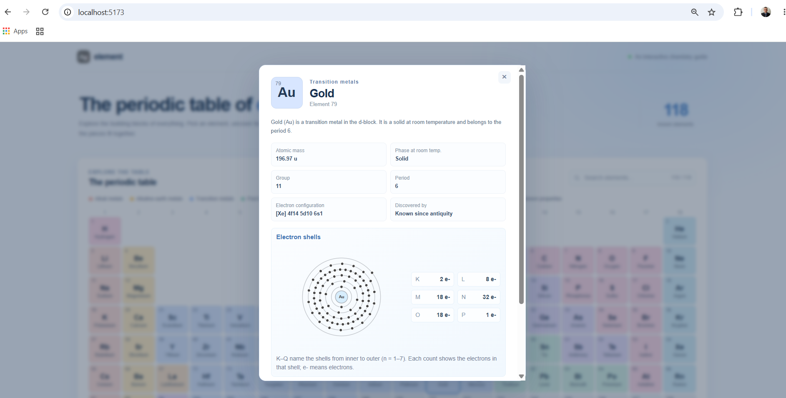

# Periodic Table Explorer

An interactive periodic table built with React, Vite, TypeScript, and Express. Select an element to see its properties, search by name or symbol, and filter by element family.



search functionality


## Requirements

- Node.js 20.19+ or 22.12+
- npm

## Start the app

From the repository root:

```bash
npm install
npm run dev
```

Open the frontend at [http://localhost:5173](http://localhost:5173). The API runs at [http://localhost:3001](http://localhost:3001), and Vite proxies `/api` requests to it.

## Other commands

```bash
npm run build       # Type-check and build the frontend, then build the backend
npm run typecheck --workspace frontend  # Type-check the React frontend
npm run test        # Run backend service tests
npm run start       # Start the compiled backend
```

## Project structure

- `frontend/` — typed React UI in TSX, search, family filters, and element details dialog.
- `backend/` — typed REST API, live public element data, and deterministic agent services.
- `backend/agents/` and `.github/agents/` — role and workflow instructions for the chemistry agents and coding assistants.

### Element data sources

The backend fetches the [PeriodicTableOfElements.org bulk element export](https://api.periodictableofelements.org/elements/export/json/) and caches the normalized records in memory for one hour. The API requires network access; if this primary source is unavailable, element endpoints return an error rather than serving stale bundled data.

| Information shown by the app | Source and mapping |
| --- | --- |
| Atomic number, symbol, name | PeriodicTableOfElements.org: `atomic_number`, `symbol`, `name`. |
| Atomic mass | PeriodicTableOfElements.org: `atomic_mass`; PubChem PUG REST `AtomicWeight` is a fallback if the primary value is missing. |
| Category | PeriodicTableOfElements.org: `category`, normalized to the app’s category names (for example, `nonmetal` becomes `reactive-nonmetal`). |
| Group and period | PeriodicTableOfElements.org: `group_number`, `period`, with layout adjustments for the detached lanthanide and actinide rows. Lanthanum and actinium stay in group 3; the other elements in those rows use display periods 8 and 9. |
| Phase at room temperature | PeriodicTableOfElements.org: `state_at_room_temp`; PubChem `StandardState` is a fallback. |
| Electron configuration | PeriodicTableOfElements.org: `electron_configuration_semantic`; PubChem `ElectronConfiguration` is a fallback. |
| Electron shells and diagram | PeriodicTableOfElements.org: `electrons_per_shell`, exposed by the backend as `electronShells`. The frontend draws the orbits and evenly spaced electron dots from those counts; dot positions are illustrative. |
| Discovered by | PeriodicTableOfElements.org: `discovered_by`. This value is not taken from PubChem or NIST. |
| Element summary | Generated by the backend from the element name, symbol, category, phase, and displayed period; it is not a source-provided field. |

[PubChem PUG REST](https://pubchem.ncbi.nlm.nih.gov/docs/pug-rest) is loaded as a secondary source for the listed fallback fields. PubChem failures are logged and do not block records available from the primary source.

The [NIST Chemistry WebBook](https://webbook.nist.gov/chemistry/) provides CGI-based, per-species HTML lookups rather than a bulk periodic-table JSON API. It is linked from the element dialog for reference, but is not scraped or used to populate the table fields. The local agent services summarize the loaded element facts; they do not call an external AI service or invent missing measurements.

### Market evolution data

The element dialog's **Market evolution** tab uses the World Bank's [Commodity Price Data (The Pink Sheet)](https://www.worldbank.org/en/research/commodity-markets), which publishes monthly nominal-USD commodity prices from 1960 to the present. The backend discovers the current monthly workbook from the World Bank page and caches it in memory for one hour. The periodic table's `$` badges are computed from the workbook's current headers and available observations; the frontend refreshes this coverage every 30 minutes. Current supported series include aluminum, copper, lead, tin, nickel, zinc, gold, platinum, and silver. Base-metal prices are in US dollars per metric tonne and precious-metal prices are in US dollars per troy ounce. These are commodity benchmark series, not a claim that every element has a directly traded pure-element price. Elements without a matching series show N/A. A source outage is shown as an error instead of being presented as missing market data.

## API

- `GET /api/elements` — list elements; accepts `q` and `category` query parameters.
- `GET /api/elements/:atomicNumber` — element facts.
- `GET /api/elements/:atomicNumber/research` — deterministic research, chemistry, and fact-check summary.
- `GET /api/elements/:atomicNumber/market?period=1y|5y|all` — World Bank monthly market-price series; defaults to five years and returns `null` when the Pink Sheet has no series for that element.
- `GET /api/elements/market-coverage` — current element price-series availability from the World Bank workbook.
- `GET /api/health` — service health.

Element measurements and classifications are presented as a learning aid. Isotope-dependent values, especially for synthetic elements, are conventional reference values rather than claims about a single stable isotope.
