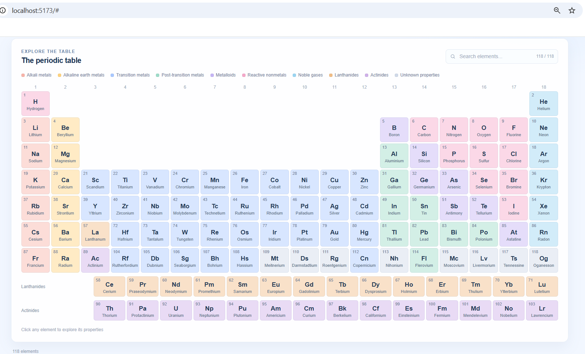
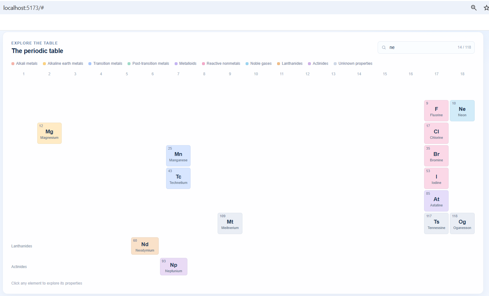
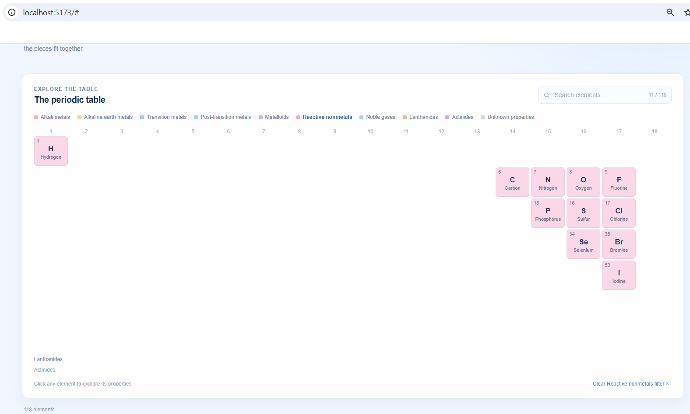

# Periodic Table Explorer

An interactive periodic table built with React, Vite, TypeScript, and Express. Select an element to see its properties, search by name or symbol, and filter by element family.


search functionality



## Requirements

- Node.js 20.19+ or 22.12+
- npm

## Start the app

From the repository root:

```bash
npm install
npm run dev
```

Open the frontend at [http://localhost:5173](http://localhost:5173). The API runs at [http://localhost:3001](http://localhost:3001), and Vite proxies `/api` requests to it.

## Other commands

```bash
npm run build       # Type-check and build the frontend, then build the backend
npm run typecheck --workspace frontend  # Type-check the React frontend
npm run test        # Run backend service tests
npm run start       # Start the compiled backend
```

## Project structure

- `frontend/` — typed React UI in TSX, search, family filters, and element details dialog.
- `backend/` — typed REST API, live public element data, and deterministic agent services.
- `backend/agents/` and `.github/agents/` — role and workflow instructions for the chemistry agents and coding assistants.

Element records are fetched from the [PeriodicTableOfElements.org API](https://periodictableofelements.org/api/) and cached in memory for one hour. [PubChem PUG REST](https://pubchem.ncbi.nlm.nih.gov/docs/pug-rest) supplements atomic mass and electron configuration when the primary record lacks them. The API requires network access on the backend; if the primary source is unavailable, element endpoints return an error rather than serving outdated bundled data. PubChem failures are logged and do not block records available from the primary source.

The [NIST Chemistry WebBook](https://webbook.nist.gov/chemistry/) provides CGI-based, per-species HTML lookup pages rather than a bulk periodic-table JSON API, so the element dialog links to its lookup instead of scraping it. The local agent services summarize the loaded element facts; they do not call an external AI service or invent missing measurements. Element values are attributed in the detail dialog.

## API

- `GET /api/elements` — list elements; accepts `q` and `category` query parameters.
- `GET /api/elements/:atomicNumber` — element facts.
- `GET /api/elements/:atomicNumber/research` — deterministic research, chemistry, and fact-check summary.
- `GET /api/health` — service health.

Element measurements and classifications are presented as a learning aid. Isotope-dependent values, especially for synthetic elements, are conventional reference values rather than claims about a single stable isotope.
